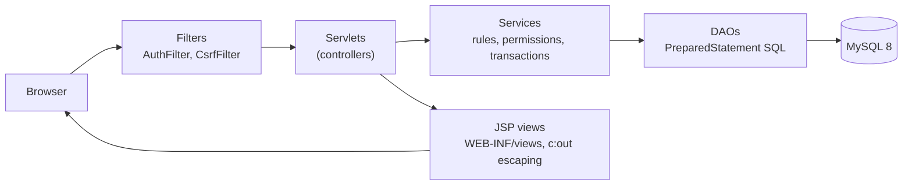
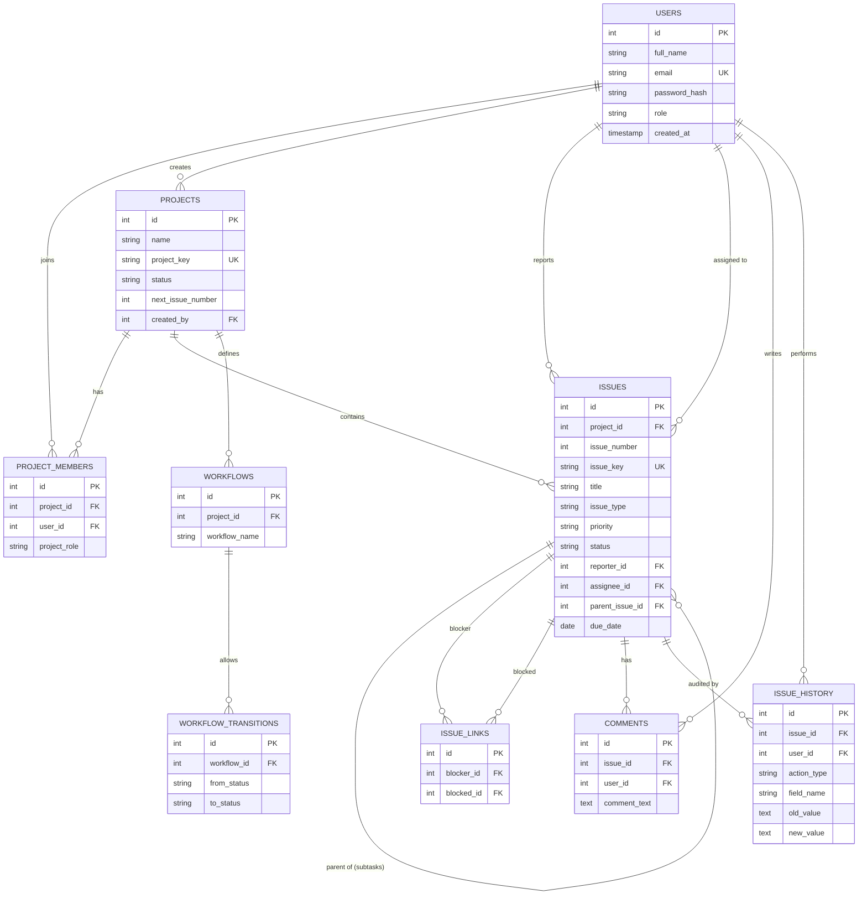
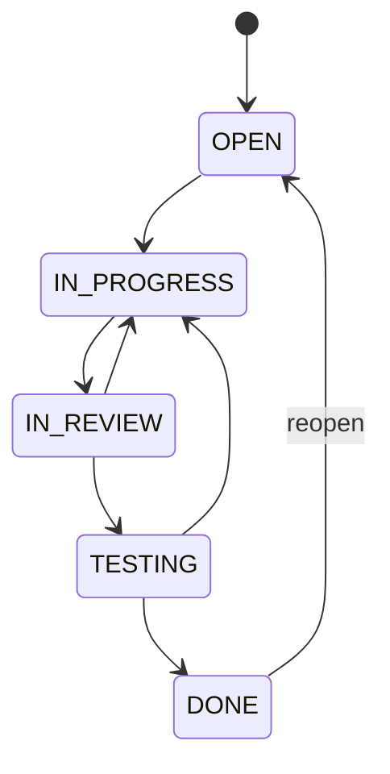
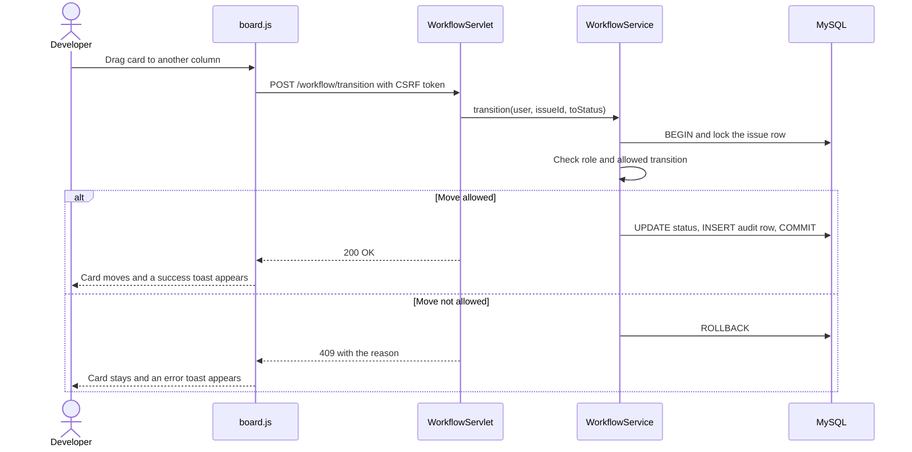

# DevFlow: Project & Issue Tracking Platform

A Jira-inspired issue tracker built with **Java Servlets, JSP, JDBC and MySQL**. Teams create projects, add members, raise issues (stories, tasks, bugs, subtasks), move them across a validated workflow on a Kanban board, discuss them in comments, and see every change in an audit history.

> Portfolio project. Built with plain Servlets/JSP/JDBC on purpose, so every layer (security, transactions, SQL) is written by hand and easy to explain.

## Features

| Area | What it does |
|---|---|
| **Authentication** | Register, login, logout, BCrypt password hashing, session timeout (30 min), session-id rotation on login |
| **Roles** | Admin, Developer, Viewer, enforced in the **service layer** (not just hidden buttons) |
| **Projects** | Create/edit projects with a unique key (e.g. `ECOM`), add/remove members, change project roles |
| **Issues** | Story / Task / Bug / Subtask, priorities, assignee, due date, parent issue, blocking links |
| **Issue keys** | `ECOM-101`, `ECOM-102`... generated with a row lock inside a transaction, so concurrent users can never get the same key |
| **Workflow engine** | `WorkflowService` is the only place that validates status changes. Transitions are stored per project in MySQL |
| **Kanban board** | Drag and drop. The browser asks the server, and the card moves only after the server approves |
| **Comments** | Add, edit (author), delete (author or project admin), chronological |
| **Audit log** | Every create, status, priority, assignee, title, description, due-date change and comment action is recorded in the same transaction as the change |
| **Smart priority** | Rule-based score (type, overdue, due soon, age, blocking) with an explanation. Never changes priority silently: you accept or ignore |
| **Dashboard + analytics** | Chart.js charts fed by live SQL, refreshed every 20 s |
| **Search** | Key/title/description search, filters (project, type, status, priority, assignee), sorting, pagination |

## Technology

Java 17, Jakarta Servlet 6 / JSP 3.1 (Tomcat 10.1), JSTL, JDBC (`PreparedStatement` everywhere), MySQL 8, Maven (WAR), jBCrypt, Gson, Chart.js, plain CSS and JavaScript, JUnit 5.

## Architecture



* **controller/** reads the request, calls a service, picks a view. No SQL, no rules.
* **service/** holds business rules and permission checks. `Tx.run(...)` wraps work in a transaction.
* **dao/** is the only place with SQL. All queries use `PreparedStatement`.
* **filter/** blocks anonymous users and checks the CSRF token on every POST.
* **util/** `DBConnection`, `PasswordUtil` (BCrypt), `ValidationUtil`, `CsrfUtil`, `Tx`.

Why it is built this way, in one line each:
* *Transactions:* creating an issue (number + insert + counter + audit row) and changing status (check + update + audit row) each commit or roll back as one unit.
* *Authorization:* a user who guesses `/issues/view?id=7` for a project they are not in gets a 404, the same as a missing issue.
* *Workflow:* the board JavaScript is only a convenience. Calling the endpoint directly cannot bypass the rules.

### Connection pooling
`DBConnection.getConnection()` opens a new connection per call (simple and correct for v1). To use a pool such as HikariCP later, change only that method to `return dataSource.getConnection();`. Nothing else changes.

## Database

`database/schema.sql` creates `devflow_db` (InnoDB, keys, unique constraints, indexes):



Two small additions to the brief: `projects.next_issue_number` (the key counter) and `issue_links` (for the "blocks another issue" rule).

### Workflow (status transitions)

Only these moves are allowed. Anything else is rejected by `WorkflowService` with a message such as "Cannot move issue from OPEN directly to DONE."



### What happens when you drag a card on the Kanban board



## Getting started

### 1. Prerequisites
JDK 17+, Maven 3.9+, MySQL 8, and **Apache Tomcat 10.1** (not 9: Tomcat 9 uses `javax.*`, this project uses `jakarta.*`).

### 2. Create the database
PowerShell does not support the `<` redirect, so use `Get-Content` (or open the files in MySQL Workbench and run them):
```powershell
Get-Content database\schema.sql | mysql -u root -p
Get-Content database\sample_data.sql | mysql -u root -p     # optional demo data (run on an empty database)
```

### 3. Configure
Copy `src/main/resources/db.properties.example` to `src/main/resources/db.properties` and set your MySQL password. This file is git-ignored.

### 4. Build and deploy
Quick way: `.\deploy.ps1` (edit the `$Tomcat` path inside first). Or step by step:
```powershell
mvn clean package
C:\tomcat10\bin\shutdown.bat
Remove-Item C:\tomcat10\webapps\devflow.war -ErrorAction SilentlyContinue
Remove-Item C:\tomcat10\webapps\devflow -Recurse -ErrorAction SilentlyContinue
Copy-Item target\devflow.war C:\tomcat10\webapps\
C:\tomcat10\bin\startup.bat
```
Open **http://localhost:8080/devflow/** (health check: `/devflow/health`).

### Demo accounts (after `sample_data.sql`)
All use the password `Password@123`.

| Email | Role |
|---|---|
| admin@devflow.dev | Admin (member of both demo projects) |
| rohan@devflow.dev | Developer |
| priya@devflow.dev | Developer (ECOM only) |
| viewer@devflow.dev | Viewer (read-only) |

Without sample data: the **first account you register becomes the Admin**. Everyone else registers as Developer or Viewer, and an admin adds them to projects.

### Run the tests
```powershell
mvn test
```
See `TESTING.md` for the manual checklist.

## Screenshots

### Dashboard


### All Issues


### Projects


### My Issues


## Project structure
```
src/main/java/com/devflow/{controller,service,dao,model,filter,util}
src/main/webapp/WEB-INF/views/*.jsp     (pages, hidden from direct URL access)
src/main/webapp/assets/{css,js}
src/test/java/com/devflow/...            (JUnit 5)
database/{schema.sql,sample_data.sql}
```

## Future enhancements
Pagination for the board, email notifications, file attachments, per-project custom workflows editor, HikariCP pooling, login rate limiting, REST API with token auth, Docker compose, migration to Spring Boot.